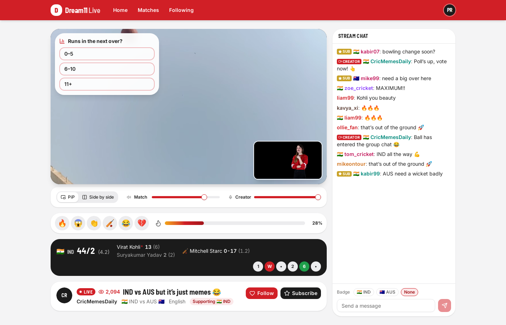
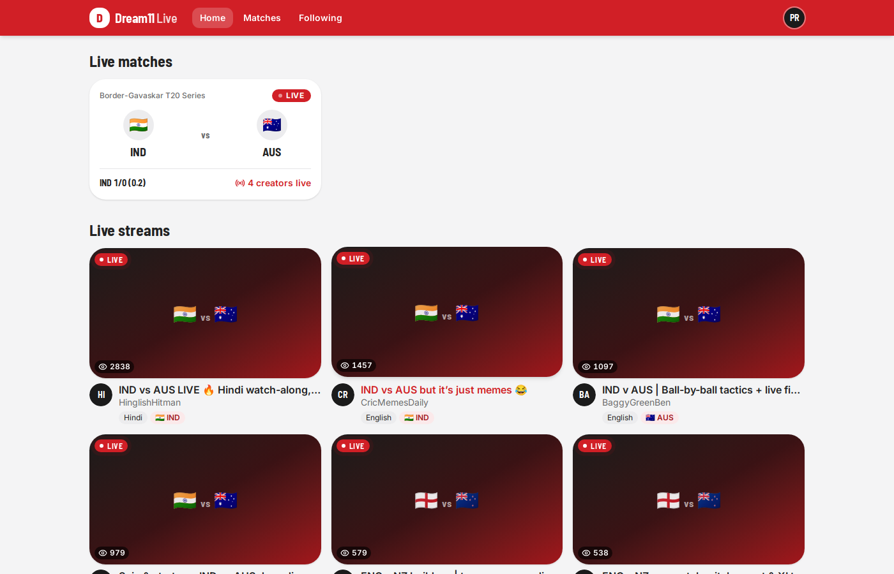

# Dream11 Live

**Watch the match through your favourite creator, with the whole crowd around you.**

A real-time cricket streaming platform: creators broadcast match watch-alongs, and fans watch, chat, react and vote
together, with a ball-by-ball scorecard under the player and everyone seeing the same ball at the same moment.

| | |
| --- | --- |
| **Live demo** | [dream11-live.vercel.app](https://dream11-live.vercel.app) |
| **Demo video** | _Link to be added_ |
| **Submission document** | [SUBMISSION.pdf](SUBMISSION.pdf) |
| **Short product note** | [SHORT_NOTE.md](SHORT_NOTE.md) |

> The web app is hosted on Vercel and the real-time server on Render's free plan. The first request after the
> server has been idle can take about a minute while it wakes up.



---

## The problem

In India, cricket is watched together. Fans argue over a bowling change, celebrate a six and groan at a dropped
catch with friends and family, and that shared reaction is half the fun of a match. But most fans now watch alone
on a phone, and the tools they have don't recreate that feeling:

- **TV and OTT streams are one-way.** You can't talk back, and nobody hears you celebrate.
- **YouTube watch-alongs scatter the experience.** The creator is in one tab, the score in another app, friends in
  a WhatsApp group. Chat scrolls too fast to read, and the stream runs 10 to 30 seconds behind, so a score
  notification often spoils the six before the creator reacts to it.
- **Creator and match are stuck together in one video.** A viewer can't turn the creator up and the match
  commentary down, or move the creator's face off the batter.
- **No home for the match.** Nothing says "IND vs AUS is live, here are the creators watching it, in Hindi, Tamil
  or English, supporting either side".

**Hypothesis:** fans will watch more of a match, and come back for the next one, when they can watch it through a
creator who speaks their language and backs their team, with the live score and the crowd's reactions in the same
place, and everyone seeing each ball at the same moment.

## The solution

A Twitch-style platform built around cricket matches instead of games.

1. **Start from the match.** Every live match has a hub page listing all the creators streaming it, with their
   language and the team they support.
2. **Watch a creator.** The match video and the creator's camera arrive as separate live streams. The viewer picks
   the layout (draggable picture-in-picture or side by side) and the audio mix (match commentary vs creator voice).
3. **Follow the game.** A ball-by-ball scorecard under the player shows the score, batters, bowler and last six
   balls, pushed live to every stream on that match.
4. **React with the crowd.** Chat with team badges, emoji reactions that float over the video and drive a hype
   meter, and polls run by the creator with live results on the video.
5. **Support creators.** Follow with go-live notifications, and subscribe to one of three tiers (mock checkout).

### Why this approach

| Option fans use today | What it misses | What Dream11 Live does |
| --- | --- | --- |
| TV / OTT broadcast | One-way, no community | Chat, reactions and polls around every ball |
| YouTube watch-along | 10–30 s delay, one baked-in video, score elsewhere | Sub-second WebRTC, separate tracks, score built in |
| Score apps, text commentary | No voice, no faces, no shared moment | A creator's voice and face, plus a live crowd |
| Discord / WhatsApp watch party | Only people you know, no discovery | A match hub with every creator streaming it |

- **Sub-second latency (WebRTC, LiveKit).** A reaction that arrives after the six feels dead. HLS streams run
  10–30 s behind; WebRTC keeps the creator, chat, reactions and scorecard on the same ball.
- **Separate tracks, mixed by the viewer.** Each viewer chooses their own layout and audio balance, which a single
  composed video (YouTube, OBS) can't offer.
- **One screen.** Score, chat, reactions and polls sit next to the video, so the fan never switches apps and never
  sees a spoiler first.
- **Ready for real rights and real data.** Because the match track is independent of the creator, a real launch can
  take the match video from a licensed feed while creators add only their face and voice. Scores come through a
  `MatchFeed` interface and video through a `VideoProvider` interface, so either can be swapped without touching
  the app.

## Alignment with Dream11's vision

Dream Sports' mission is to **Make Sports Better**, and Dream11's strength is being where fans are during a live
match. Dream11 Live extends that from picking a team before the toss to **watching the whole match together**.

- **Engagement for the whole match, not just before it.** Fans stay in the app for every ball of a three-hour
  match instead of opening it only before the toss.
- **Engagement that doesn't depend on money.** Since India's 2025 online gaming law ended paid contests, community
  and content have to keep fans coming back: creators, chat, polls and (next) free predictions do exactly that.
- **A creator economy for Indian cricket.** Regional-language creators get an audience and earn through
  subscriptions, and they bring their own communities with them.
- **Fits the Dream Sports family.** Licensed match video (for example through FanCode) can drop into the match
  track, with Dream11's fan base providing the audience.

---

## Try it

| Account | Password | Role |
| --- | --- | --- |
| `priya`, `arjun`, `sam` | `pass` | Viewer |
| `RohitReacts`, `AussieAnalyst`, `CoverDriveComedy` | `pass` | Creator |

Or sign up with your own name. Six creator streams are always live, with chat, reactions, polls and a ticking
IND vs AUS scorecard, so there is something to watch straight away. To go live yourself, log in as a creator,
open the dashboard, pick a video file and allow the camera.

## Features

- **Going live:** a local video file (`captureStream()`) and a webcam, published as separate LiveKit tracks.
- **Watching:** draggable PiP or side by side, separate volume sliders for match audio and creator voice.
- **Chat:** real time, with team, CREATOR and SUB badges; the creator can delete messages and ban users.
- **Reactions:** six emojis float over the video; a hype meter tracks a rolling 5-second window.
- **Polls:** the creator opens one, viewers vote once, and results update live on the video.
- **Live scores:** a ball-by-ball match feed, fanned out to every stream on that match.
- **Discovery:** home, matches, and a match hub with every creator streaming it.
- **Social:** follow, a Following page, go-live toasts, and three subscription tiers with a checkout dialog.
- **Demo mode:** a server-side bot director keeps six streams live with persona-driven chat, event-reactive
  hype and self-running polls.



## Tech stack

| Layer | Technology |
| --- | --- |
| Frontend | React 19, Vite 8, TypeScript, Tailwind CSS 4, shadcn/ui (Radix), TanStack Query, Zustand, Motion |
| Backend | Node.js 22, Fastify 5, Socket.IO 4, Zod 4 |
| Data | Prisma 6 on SQLite (switches to Postgres with one line) |
| Video | LiveKit Cloud (WebRTC SFU), livekit-client, livekit-server-sdk |
| Tooling | pnpm workspaces, strict TypeScript, Playwright (headless end-to-end checks), FFmpeg |
| Hosting | Vercel (web), Render via Docker (server) |

## Architecture

```
 Creator studio ──4 tracks──▶ LiveKit Cloud SFU ──subscribe──▶ Viewer
       │                          ▲  (scoped tokens)                │
       └──── REST + Socket.IO ────┼──────── REST + Socket.IO ───────┘
                                  │
   Node.js service:  Fastify REST · Socket.IO rooms · Match feed · Bot director
                                  │
                           Prisma + SQLite
```

Video and audio go through LiveKit; app state, chat, reactions, polls and scores go through one Node.js service.
`packages/shared` holds every socket event name, payload type and Zod schema, so the client and server share one
contract. The full system design (scope, data model, API) is in [DESIGN.md](DESIGN.md).

## Problems faced and how I solved them

| Problem | Solution |
| --- | --- |
| Two video sources with separate audio from a browser was the riskiest part: without it, no custom layouts or audio mix | A spike built and tested headless on LiveKit Cloud before anything else; the app was planned only after it passed |
| Testing live video without a person; Playwright's Chromium can't play H.264 | WebM test media made with FFmpeg, and Chromium with a fake camera and mic, so every feature is checked automatically |
| Switching to side by side soon after joining left the match video black | The layout switch remounted the video while LiveKit's adaptive stream had paused it; the video element now stays mounted |
| Reactions could flood the server and showed twice for the tapper | Taps batched every 250 ms on the client, aggregated on the server into four bursts a second; the tapper's echo is subtracted |
| No reliable live cricket data (free APIs have low daily limits) | A `MatchFeed` interface with a ReplayFeed that plays a recorded innings ball by ball at any speed |
| An empty platform looks broken to a first visitor | A bot director: six creator personas with real footage, 60 chatters reacting to each ball, self-running polls |
| WebSockets don't run on serverless hosting; the free server has no disk | Web on Vercel, the Socket.IO server in Docker on Render; an idempotent seed rebuilds demo data on every restart |

## What's next

1. **Ball-by-ball predictions with leaderboards.** Viewers predict each over ("runs this over", "wicket?") for free
   points; the match feed settles them automatically; each stream gets a leaderboard the creator can call out live.
   Dream11's fantasy strength, brought into the live moment.
2. **Real live data and auto-clips.** A live cricket API behind the existing `MatchFeed`, and score events that
   automatically clip the creator's reaction to every wicket and six (LiveKit Egress) for the match page.

## AI tools

I used **Claude Code** (Anthropic) as a pair programmer: to write the design doc and a time-boxed build plan, write
and review code phase by phase, test every feature in a headless browser and read the screenshots, convert stock
footage, set up the deployment and write the docs. The product decisions (the problem, scope, design and tech
trade-offs) were mine.

---

## Run locally

Requires Node.js 22+, pnpm 9 and a free LiveKit Cloud project.

```bash
pnpm install
cp apps/server/.env.example apps/server/.env   # fill in the LIVEKIT_* values
pnpm db:migrate && pnpm db:seed
pnpm dev                                        # web on http://localhost:5173, server on :3001
```

`pnpm typecheck` checks all three packages. `pnpm replay start` restarts the match replay.

## Deploy

- **Web (Vercel):** `vercel.json` builds `apps/web`. Set `VITE_API_URL` to the server's URL.
- **Server (Render):** `render.yaml` + `Dockerfile` (New, then Blueprint). Set the three `LIVEKIT_*` values.
  `CORS_ORIGIN` already allows `https://*.vercel.app`.
- **One service:** `pnpm build && pnpm start` serves the web app, API and sockets from one origin.

## Repository

```
apps/web         React app: pages, player, chat, reactions, polls
apps/server      Fastify + Socket.IO server, Prisma schema, match feed, bot director
packages/shared  Shared event names, types and Zod schemas
spike/           The WebRTC proof of concept, with a headless publish-and-watch test
docs/            Submission document source, demo video script, screenshots
DESIGN.md        System design: scope, architecture, data model, API
plan.md          Delivery plan and progress
```

`node docs/make-pdf.cjs [video-url]` rebuilds `SUBMISSION.pdf` from `docs/submission.html`.

Demo footage: Pixabay (free licence), sources in `apps/web/public/bots/CREDITS.txt`.
